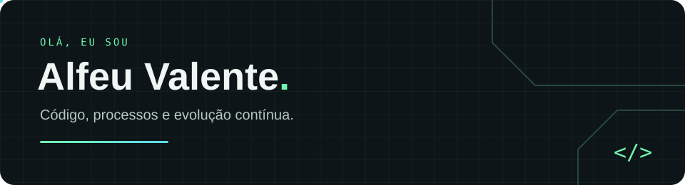

**Programação • Engenharia de Produção • Melhoria contínua**

Conectando o raciocínio da engenharia à criatividade do código.

### Um pouco sobre mim

Gosto de resolver problemas, tanto na programação quanto na melhoria de processos de produção. Por aqui, compartilho projetos, exploro tecnologias e sigo aprendendo na prática.

> Aprender, construir, melhorar. E repetir. ↗

### Tecnologias que exploro

  &nbsp;
  &nbsp;
  &nbsp;
  &nbsp;
  &nbsp;
  &nbsp;
  

JavaScript · TypeScript · React · HTML · CSS · Python · C#

